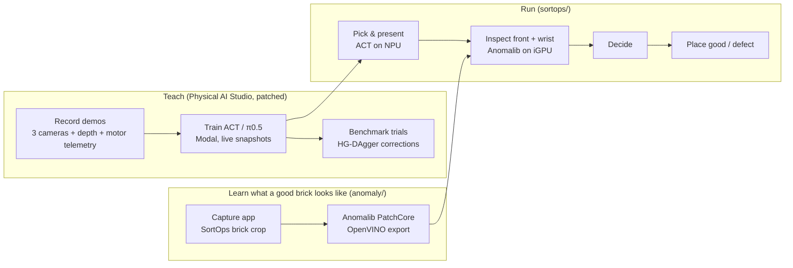

# NeatPick

An SO-101 arm that picks Duplo bricks, shows each one to its cameras, decides whether it is defective and drops it in
the right bin. Nobody tells it what to do during a run. Built in 48 h for the Intel Physical AI challenge at Junction
2026, on one Intel Core Ultra laptop: the policies run on the NPU and the anomaly models on the integrated GPU.

## What is in this repository

| Folder | What it is | Start with |
|---|---|---|
| [`sortops/`](sortops/) | **SortOps**, the web app that runs the sorting cell end to end: policies, inspection, decision, safety, metrics. | [`sortops/README.md`](sortops/README.md) |
| [`studio/`](studio/) | Our changes to Intel's **Physical AI Studio** (recording, training, evaluation), one patch on top of the upstream `junction2026` branch. Each change comes with its justification. | [`studio/README.md`](studio/README.md) |
| [`anomaly/`](anomaly/) | Tools to build the **Anomalib** dataset of good bricks and check it before training: capture app, dataset report, quick evaluation, plus two Anomalib Studio fixes. | [`anomaly/README.md`](anomaly/README.md) |

## Guided tour

1. **Record demonstrations** in Physical AI Studio with the leader arm. Our patch adds motor telemetry (load, current,
   temperature) next to the joint positions, RealSense depth, lens undistortion, camera crop/zoom, and tags and markers
   on the episodes. You can then copy a dataset while keeping only some cameras, tags or segments.
2. **Train** ACT or π0.5 on Modal from the Studio UI. Several runs can go at once, checkpoints become usable models
   *during* training (`<name>-stepN`), and a run stops by itself when its loss reaches a target.
3. **Evaluate on the arm.** In the Studio inference view, *Benchmark* runs N timed trials. A human marks each trial
   Success or Fail, then the arm goes home on its own. You get a success rate with a Wilson 95 % interval. *Pause and
   correct* (HG-DAgger) lets the operator take over with the leader arm. Only the corrected segment is recorded, and
   *Fine-tune now* resumes training from the model's weights.
4. **Teach the inspection.** `anomaly/capture_app.py` shoots good and defective bricks, cut by the same brick-crop
   code SortOps runs. `dataset_report.py` and `quick_eval.py` tell you whether the dataset is good enough before you
   train PatchCore in Anomalib Studio.
5. **Run the cell** with SortOps (`sortops/run.sh start`, http://127.0.0.1:8200):
   - Shadow mode first: models run, the 3D view shows what the arm would do, and the motors stay still.
   - Then Live, with STOP on the space bar.
   - The Cockpit shows every transition criterion as it is evaluated, every inspection frame with its anomaly map,
     and the decision with its reason.
   - It also shows latency per model and device, cycle time, energy and accuracy against the operator's labels.

## Requirements

- An SO-101 follower (and leader arm for teaching), a RealSense D415 for the front and overhead views, a USB wrist
  camera.
- Ubuntu with Intel GPU/NPU drivers, and Physical AI Studio installed from the `junction2026` branch (see
  [`studio/README.md`](studio/README.md)). SortOps and the capture app run in Studio's Python environment (`physicalai`,
  OpenVINO, SO-101 plugin).
- Without hardware, SortOps runs in simulation with a simulated arm, bricks and cameras, executing the same cycle code
  (`sortops/README.md` → *Simulation*).

## Tests

- SortOps backend: `cd sortops/backend && pip install -e '.[dev]' && pytest` (120 tests, simulated cell included).
- The Studio patch adds its backend and UI tests under `application/backend/tests` and `application/ui/src`.

## License

Apache-2.0, like Physical AI Studio and Anomalib, which the patches in `studio/` and `anomaly/patches/` modify.
