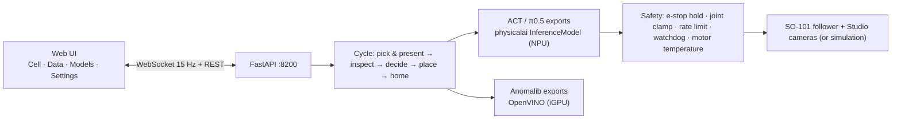

# SortOps

SortOps runs the sorting cell. In a loop, it picks a brick, presents it to the cameras, scores it with an anomaly model
per camera, decides and places it, with nobody choosing the next action. The backend is FastAPI and drives the SO-101
and the Studio cameras. The web UI is React + three.js: a live 3D arm, the cameras, the inspection and the metrics.



## Run

**On the robot PC.** SortOps runs in Physical AI Studio's backend venv, which already provides `physicalai`, the SO-101
plugin and OpenVINO:

```bash
STUDIO_DIR=~/physical-ai-studio ./run.sh install   # builds the UI, installs the systemd --user unit "sortops"
./run.sh start                                      # http://127.0.0.1:8200   (stop | restart | status | logs)
```

Set the `hardware` section of `data/config.json` before the first start: follower serial port, calibration file, Studio
URL and project, and model folders. The arm port is exclusive: close any Studio session that uses the follower first.
The cameras are shared with Studio.

**Simulation** (no hardware: simulated arm, bricks and cameras, scripted gestures, the same cycle code):

```bash
cd web && npm ci && npm run build
cd ../backend && pip install -e '.[dev]' && python -m sortops     # http://127.0.0.1:8200
pytest                                                           # 120 tests
```

## The cycle

1. **Pick & present.** The `pick_present` policy runs with the execution settings of Studio's *Run model*:
   synchronous or asynchronous, action rate, and when to request the next chunk. Chunks are blended over 5 actions. The
   step moves on when **explicit gates** pass, each shown live with its measured value and target:
   - **Brick held**: read on the gripper motor (`pipeline/grasp.py`). The gripper must be closed, but not fully, while
     squeezing. Measured: holding a Duplo reads position ≈ 3 and load 17-20; closed on nothing reads ≈ 1 and 2-5.
   - **Admissible frames in the admission zone**: a frame is admissible when a brick is seen in the crop. The zone
     around the taught inspection pose widens by 50 % every 10 admissible frames, so a brick presented slightly off the
     pose is still inspected.
   - **Inspection window**: long enough for the wrist to show both faces.

   No brick held after 20 s: the arm goes home, waits 0.5 s and tries again. Optionally, a recorded Studio episode
   presents the brick instead of a model (`present`).
2. **Inspect.** Every inspection camera (front and wrist) is cut by `pipeline/brick_crop.py`. This is the same code the
   Anomalib capture app uses, so training photos and live frames match. Each frame is rated for usability (sharpness,
   exposure, brick present, pose, speed). The best frame of each camera is scored by that camera's own model. The score
   (`pipeline/anomaly_score.py`) combines the localized peak and the whole-map mean of the anomaly map, both measured
   in good-brick units after a calibration on good bricks. A classical colour-statistics check (`pipeline/cv_anomaly.py`)
   gives a second, independent opinion.
3. **Decide.** The per-camera scores are fused (max, mean, min or weighted) and compared to the good and defect
   thresholds. A brick in the gray zone gets fresh frames. Still uncertain: defect bin. In operator mode, a person
   answers instead of the model (G, D, N) and can draw the brick and its defects. That labels the data for the next
   model.
4. **Place.** The `place_good` or `place_bad` policy runs, or a recorded deposit is replayed. A release reflex opens
   the gripper wide as soon as the policy starts to open it. The gripper must be open before the arm goes home.

Every transition is written to the cycle's decision log with its reason (Cockpit, cycle table, CSV).

## Safety

- The cell starts in **Shadow**: models run, the 3D view shows the policy target and the motors stay still. **Live**
  needs a confirmation.
- **STOP** (button or Space) latches an e-stop. The arm holds its position, and a lock guarantees that no command
  follows the hold.
- Every target is clamped to soft joint limits and to a maximum step per tick. In Live, the UI must send a heartbeat
  (watchdog). An overheat stop triggers on the per-motor median temperature over 5 s.
- A home move is only trusted once home is reached. If it is not, the arm holds and no new pick starts.
- `hardware.arm_access = "read_only"` never writes torque or goals.

## Data and models

- **Data tab.** Every inspection frame is kept per run: full image, model crop, raw anomaly map. You can review and
  annotate frame by frame (piece box, defect boxes or brush), then export an Anomalib Folder/MVTec zip, or train an
  anomaly model (PatchCore, PaDiM, …) with Anomalib's own Python.
- **Models tab.** It lists the Studio model catalogue per role and imports the latest export (snapshots included). For
  each role you choose the device (CPU, GPU or NPU) and can benchmark latency on every device. Anomaly models get a
  calibration on good bricks or a manual defect line, with the live raw score shown.
- **Metrics.** Latency per model and device, cycle time, package energy (RAPL), throughput, and a confusion matrix
  against the operator's labels. Export as CSV or as a JSON report (config, model provenance, cycles).

Measured on the Core Ultra (`python -m sortops.smoke`, 20 runs, synthetic observation):

| ACT export | CPU p50 | iGPU p50 | NPU p50 |
|---|---|---|---|
| pick & present (2 699 steps) | 197 ms | 73 ms | **36 ms** |
| place defect (2 999 steps) | 524 ms | 69 ms | **35 ms** |

## Code

| Path | Role |
|---|---|
| `backend/sortops/cell.py` | the cell: hardware, models, cycle state machine, step-1 gates, inspection |
| `backend/sortops/safety.py` | e-stop, clamp and rate limit, watchdog, temperature, shadow/live |
| `backend/sortops/pipeline/` | brick crop, usability and decision, anomaly score and maps, grasp, chunk player, replay, annotation store |
| `backend/sortops/models/` | Studio catalogue and import (`registry.py`), OpenVINO and physicalai runtimes (`runtime.py`) |
| `backend/sortops/hw/` | SO-101, Studio cameras, simulator |
| `backend/sortops/anomaly_train.py`, `anomaly_worker.py` | Anomalib training on reviewed frames, in Anomalib's venv |
| `backend/sortops/server.py` | REST and WebSocket API; serves the UI |
| `web/` | Vite + React + three.js UI |

Settings live in `data/config.json`; the defaults and their bounds are in `backend/sortops/config.py`. Everything except
`hardware` can be edited from the Settings tab.
